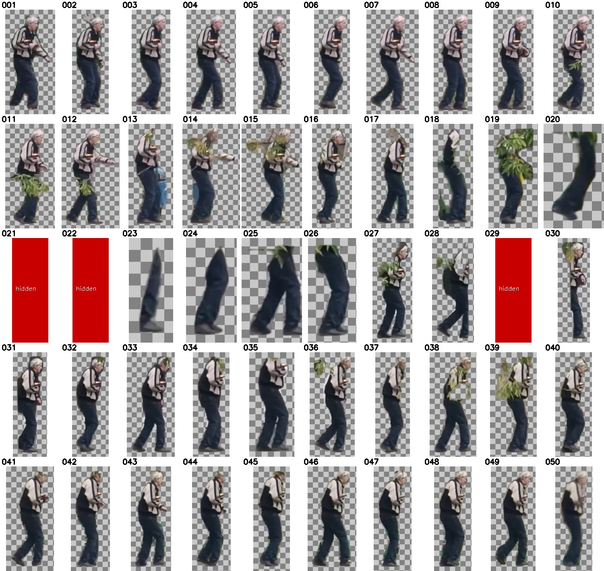

# Вырезание идущего человека из видео VID.mp4

Видео `VID.mp4` (720×1280, 477 кадров, 30 fps, ~15.9 с) нарезано на **50 равномерно
распределённых кадров**, в каждом кадре убран фон — оставлен только идущий человек
на прозрачном фоне.

## Результаты — папка `output/`

| Папка / файл | Содержание |
|---|---|
| `output/frames/` | 50 исходных кадров видео (`frame_001.jpg` … `frame_050.jpg`) |
| `output/frames_no_bg/` | Те же 50 кадров **без фона**: полный размер 720×1280, PNG с прозрачностью, только человек |
| `output/person_cropped/` | 47 картинок: тот же человек, но обрезанный по контуру (bounding box маски + 12 px), PNG с прозрачностью |
| `output/report.csv` | Соответствие: файл → номер исходного кадра видео, время (с), статус, уверенность детектора, координаты человека |
| `output/preview_person_cropped.jpg` | Контактный лист всех вырезанных кадров на шахматной подложке |



### Важное про 3 кадра

На кадрах **frame_021, frame_022 и frame_029** человек в исходном видео **полностью
скрыт за стволом дерева / столбом** — вырезать там нечего. Поэтому:

- в `frames_no_bg/` эти файлы есть, но полностью прозрачные;
- в `person_cropped/` этих трёх файлов нет;
- в `report.csv` у них статус `not_found`.

На соседних кадрах участка за деревьями (frame_020, 023–026) видны только ноги —
они и вырезаны. Там, где ветки/листва находятся перед человеком, небольшие
фрагменты листвы могли остаться внутри контура.

## Как сделано

Скрипт [`scripts/extract_person_frames.py`](scripts/extract_person_frames.py):

1. OpenCV читает видео и берёт 50 кадров через равные промежутки
   (`np.linspace(0, 476, 50)`).
2. Сегментация человека — **YOLOv8n-seg** (ONNX, класс COCO `person`) через
   onnxruntime. Модель запускается на полном кадре и на тайлах 640×640 —
   так надёжнее находится человек небольшого размера; для кадров с сильной
   окклюзией есть fallback-проход зум-тайлами с пониженным порогом.
3. Мягкая (probabilistic) маска превращается в альфа-канал с гладким краем,
   мелкие ложные компоненты удаляются, результат пишется в PNG.
   Под прозрачными пикселями RGB обнулён, поэтому файлы маленькие.

Модель: `models/yolov8n-seg.onnx` — YOLOv8n-seg (Ultralytics, лицензия AGPL-3.0),
ONNX-файл взят из репозитория
[Hyuto/yolov8-seg-onnxruntime-web](https://github.com/Hyuto/yolov8-seg-onnxruntime-web/tree/main/public/model).

## Повторный запуск

```bash
python3 -m venv .venv
.venv/bin/pip install -r requirements.txt
.venv/bin/python scripts/extract_person_frames.py \
    --video VID.mp4 --count 50 --model models/yolov8n-seg.onnx --out output
```

Параметры: `--count` — сколько кадров нарезать, `--conf` — порог уверенности
детектора (по умолчанию 0.32).
